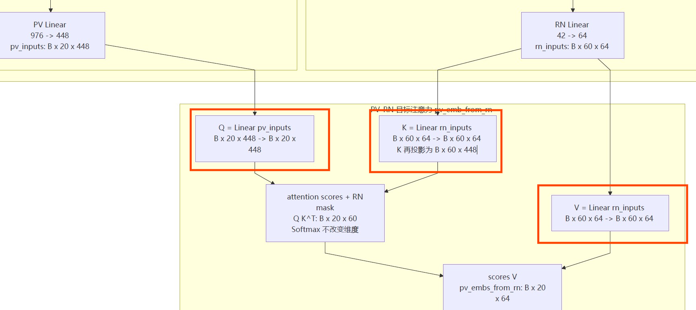

# 推荐算法基础知识

## 基础

### 名词

- **Recall**：召回

- **Coarse Ranking / Pre-ranking**：粗排

- **Ranking**：精排

- **Re-ranking**：重排

- **GMV**：总成交额

- **冷启**：（训练任务冷启）不读取已有模型的 checkpoint，从随机初始化或指定的初始参数开始，完整地重新训练模型

- **热启 / 续训**：加载昨天第 100 万步的 checkpoint → 从已有参数继续训练

- **Checkpoint**：模型训练到某个时刻时保存的一份“进度存档”，通常包括

  当前模型参数，如权重和偏置、当前训练步数、有时还包括优化器状态

  加载 checkpoint 后，模型可以从上次保存的位置继续训练，而不用从头开始

  不加载旧 checkpoint，从随机参数开始训练，就是冷启

- **bid**：$\text{bid}_i$ 指第 $i$ 个广告或商品对应的 **出价**，广告排序用公式
  $$
  \text{score}_i
  =
  \widehat{\text{CTR}}_i
  \times
  \text{bid}_i
  $$
  可能某商品的 $\widehat{\text{CTR}}_i$ 更低，但是出价高，从而最终

- **重定向商品、非重定向商品**：按“当前用户—当前商品”这一对来判断

  **非重定向商品**：用户以前没有点过这个商品，相当于第一次向用户推荐

  **重定向商品**：用户以前点过这个商品，但可能没有购买，现在又把它推荐给用户，相当于“再次推荐”

  即依据用户过去是否有点击过

- **batch size**：一次训练迭代中，同时送入模型的样本数量

  比如完整训练集有 100 万个样本，但设置 batch size 为 1024，则训练时，第一次
  $$
  \{x_1,\dots,x_{1024}\}
  $$
  第 2 次
  $$
  \{x_{1025},\dots,x_{2048}\}
  $$
  每次取出来的这个样本集合，是一个 **mini-batch**

  - **普通 CTR**

    一次 mini-batch 可能是 $X\in\mathbb{R}^{B\times d}$，表示 $B$ 个样本，$d$ 个特征

  - **我的项目 PV CTR**

    $X\in\mathbb{R}^{B\times M\times d}$，多的 $M$ 表示每个页面中有 $M=20$ 个商品

- **pCTR**

  **CTR**：真实点击率，是统计出来的实际点击比例
  $$
  \mathrm{CTR}=\frac{\text{点击次数}}{\text{曝光次数}}
  $$
  **pCTR**：预测点击率，是 **模型** 对某个样本被点击概率的预测
  $$
  \mathrm{pCTR}=\hat p(y=1\mid \mathbf x)
  $$
  

#### 赔率 odds

正负样本概率的比值，也叫 **优势比**
$$
\text{odds}=\frac{p}{1-p}
$$
例：

> 点击概率比较高时，设 $p=0.8$，则
> $$
> \text{odds}=\frac{0.8}{1-0.8}=4
> $$
> 表示点击发生的可能性是不点击的 4 倍
>
> 点击概率比较低时，如 $p=0.2$，则
> $$
> \text{odds}=\frac{0.2}{0.8}=0.25
> $$
> 点击发生的可能性是不点击的 $\frac{1}{4}$

#### 对数赔率 log odds

也叫 **logit**

```python
tf.log(odds)
```

$$
z= \operatorname{logit}(p)
=
\log\frac{p}{1-p}
$$

```python
@staticmethod
def stable_inverse_sigmoid(value, epsilon=1e-10):
    odds = value / tf.maximum(1.0 - value, epsilon)
    odds = tf.clip_by_value(odds, epsilon, 1.0 / epsilon)
    return tf.log(odds)
```

- 不能用 max()，这里 value 可能是张量（矩阵、向量 ）

和 sigmoid 是互逆关系
$$
p=\sigma(z)=\frac{1}{1+e^{-z}}
$$

- $p$：概率
- $z$：logit

sigmoid：logit → $p$

logit：$p$ → logit

#### concat

concatenation 向量拼接，数学表示为 $z = [x;y]$ 或 $z = \text{concat}(x,y)$

#### padding

在深度学习模型中，经常需要把不同长度的序列**统一到固定长度**，以便批量计算

如：一个页面可能只有 6 个商品，但模型要求输入 20 个商品，那么剩下的 14 个位置就用**特殊值（通常是 0）填充**，这些填充的 **位置** 就叫**padding**

#### 首单 末单 CVR

**首单 CVR**：预测用户面对一个以前没点过的商品时，购买的概率

**末单 CVR**：预测用户已经点过某个商品，再次看到它时，购买的概率

具体例子

> 用户昨天点过一双鞋 A，但没有购买，今天再次推荐这双鞋 A
>
> → 这是重定向商品，使用末单 CVR 分
>
> 用户以前没有点过一个书包 B，今天第一次推荐这个书包 B
>
> → 这是非重定向商品，使用首单 CVR 分


#### 前向计算

给定输入，从网络的输入层开始，一层一层往后算，最终得到输出

---


#### GMV

GMV：Gross Merchandise Value，成交总额

是成交订单金额，不是平台的抽佣

如一天有 3 笔订单，分别为100、20、50元，则 $\text{GMV} = 170$


> 在推荐、广告、多任务学习里，GMV 也经常作为一个 **优化目标**。比如一个电商推荐系统可能同时预测 CTR、CVR、GMV（这个推荐最终可能带来多少成交金额）

---


### 训练流程

前向计算 → 得到预测值 → 计算 loss → 反向传播 → 更新参数

---


### 符号

$v_i$ 物品 i 在所有用户上的累计 utility（效用、收益）
$$
v_i=\sum_{u\in U} w_{u,i}x_{u,i}
$$
固定商品 $i$，遍历所有用户 $u$

比如固定商品 $i=A$，那么公式变成：

$$
v_A=\sum_{u\in U} w_{u,A}x_{u,A}
$$

这里求的是商品 $A$ 的总 utility

假设用户集合为

$$
U=\{u_1,u_2,u_3\}
$$

那么：

$$
v_A
=
w_{u_1,A}x_{u_1,A}
+w_{u_2,A}x_{u_2,A}
+w_{u_3,A}x_{u_3,A}
$$

每一项 $w_{u,A}x_{u,A}$，表示用户 $u$ 对商品 $A$ 贡献的 utility：

- $w_{u,A}$：用户 $u$ 对商品 $A$ 的预测偏好分数
- $x_{u,A}=1$：商品 $A$ 被推荐给用户 $u$
- $x_{u,A}=0$：商品 $A$ 没被推荐

---


### 排序方法

- Point-wise，不直接学习物品之间的排序关系，而是把每一个候选物品单独拿出来预测一个分数，然后根据分数排序
- Pair-wise，每次比较两个物品，学习“谁应该排在前面”
- List-wise，把整个候选列表作为一个训练样本，直接学习“整个列表应如何排序”

---


### RN 

$$
\text{RN} \rightarrow \text{提供额外上下文} \rightarrow \text{帮助修正每个 PV item 的 CTR}
$$

**Reference/Related Neighbor 信息**

RN 不是最终要预测点击的主商品列表，而是 **辅助 PV 商品做判断的额外上下文**

> PV 序列 = 当前页面展示的商品
>
> [手机壳 A, 充电器 B, 耳机 C]
>
> 每个 PV 商品旁边可能有一些相关参考商品：
>
> ```
> 手机壳 A 的 RN = [相似手机壳 1, 相似手机壳 2]
> 充电器 B 的 RN = [相似充电器 1, 相似充电器 2]
> 耳机 C 的 RN = [相似耳机 1, 相似耳机 2]
> ```
>
>  RN 序列整体可能
>
> ```
> [
>   相似手机壳 1, 相似手机壳 2,
>   相似充电器 1, 相似充电器 2,
>   相似耳机 1, 相似耳机 2
> ]
> ```
>
> RN 长度 = self.max_len * self.rn_max_len
>
> PV 长度 L = 3
>
> 每个 PV 对应 RN 数 R = 2
>
> RN 总长度 = L * R = 6


PV 是当前要预测的商品序列，RN 是可以帮助 **修正** 这些 PV 商品预测的相关/参考商品序列

**原来只看 PV 商品自己，模型可能判断不准；加入 RN 后，模型能参考相关商品的表现/属性，把 CTR 往更合理的方向调**

举个简单例子：

```
PV item = 某款耳机
base CTR = 0.10
```

只看它自己，可能预测 CTR = 0.10

- 调大 CTR 的例子：

  假设 RN 里有相关商品：RN = [ 相似耳机 A CTR 很高, 相似耳机 B 销量很好, 相似耳机 C 价格更低 ]

  模型看到这些上下文后，可能认为：这个 PV item 所在的相关商品环境整体不错

  于是把预测修正为：CTR = 0.13

- 减小 CTR 的例子：

  如果 RN 显示：相似商品点击都低、价格更有竞争力的替代品很多

  模型可能把它修正为：CTR = 0.08

在代码里，这种“帮助”大概是：PV item 向量 + 从 RN attention 得到的参考向量

然后一起送进主模型，让模型学习：最终 CTR = 原始基础 CTR + RN/PV 上下文带来的修正量

所以不是人工写规则修正，而是模型通过训练学会什么样的 RN 信息应该让某个 PV item 的 CTR 上调或下调

---


### 消融实验

在一个完整模型的基础上，逐步去掉某些模块、特征、损失函数或者结构设计，然后观察模型性能变化，从而验证每个设计是否真正有效

一个模型可能有若干个创新点，消融实验要将这一个个创新点拆掉，看性能下降了多少

---


### 负采样

**引入**：原始数据里负样本太多，所以不把所有负样本都拿来训练，而是只抽取其中一部分。假设原始数据有 1 万个正样本、100 万个负样本，如果全部训练是 1:100，如果从 100 万个负样本中随机抽取 10 万，此时的比例为 1:10

> 在推荐系统中，通常：点击的商品为 **正样本**，曝光但没有点击的样本为 **负样本**


**面试概述**

负采样就是在负样本数量远多于正样本时，只选取部分负样本参与训练，从而减少计算量，并缓解类别不平衡问题


**目的**

- **减少训练数据量**

  原本要把 “所有负样本” 都送进模型训练，而负采样后，只需要训练其中的一部分负样本，每个 epoch 需要处理的样本总量减少了

- **降低计算成本**
- **缓解正负样本极度不平衡**


**问：负采样是否对 AUC 有影响**（字节）

> 负采样是否影响 AUC，要看 **采样方式**
>
> 如果是对负样本进行 **均匀随机采样**，那么由于 AUC 本质上衡量的是随机正样本得分高于随机负样本得分的概率，所以理论上 AUC 的期望不会改变，只是负样本减少以后估计 **方差** 会增大
>
> 如果负采样改变了负样本的分布，比如进行了 hard negative sampling，那么直接在采样后的数据上计算 AUC 就会产生偏差

- **hard negative sampling**

  不是从所有负样本里随机抽，而是更倾向于抽那些“模型容易误判成正样本”的负样本

  **例子**

  > 用户点击了某个篮球鞋（正样本）。负样本里可能有两类：
  >
  > ① 一类是完全不相关的：如锅、牙刷等
  >
  > ② 一类是很相似但是没有被点击的（还是负样本）：其他的运动鞋

  


## 指标


### COPC

$$
\boxed{
\text{COPC}
=
\frac{\sum_{i=1}^N y_i}{\sum_{i=1}^N \hat p_i}
}
=
\frac{\text{真实点击数}}{\text{预测点击数}}
$$

用于衡量模型预测的整体点击量，是否与 **真实点击量** 一致

在 CTR 预估中，模型会为每条曝光预测一个点击概率 $p_i$，真实标签为 $y_i\in\{0,1\}$

COPC 越接近 1，整体概率校准越准确（全局校准）

若 $\text{COPC} >1$，模型低估 CTR

若 $\text{COPC} <1$，模型高估 CTR


**实例**

> COPC = 1.017839，说明 **真实点击量比预测点击量高约 1.78%**，模型轻微低估
>
> COPC = 0.995768，说明 **真实点击量比预测点击量低约 0.42%**，模型轻微高估


**改损失函数，让 AUC、PR-AUC 等指标提升，但是 COPC 没有提升的原因**

> 排序能力：AUC、PR-AUC
>
> 校准能力：COPC
>
> 假设模型对两个商品预测 $\hat p_1=0.10$、$\hat p_2=0.05$，只要真实的情况是第一个商品真实点击、第二个没点击，此时 **排序** 是正确的
>
> 假如修改损失后变成了 $\hat p_1' = 0.30$、$\hat p_2' = 0.10$，此时排序仍然是正确的，排序变得更加明显，AUC 有可能会整体提高。因此 COPC 定义中分母提高，COPC 变小

**代码**

```python
def copc(labels, preds):
    pred_sum = sum(preds)
    if pred_sum == 0:
        return float('inf')
    return sum(labels) / pred_sum
```

算例

```python
labels = [1, 0, 1, 0]
preds = [0.8, 0.2, 0.6, 0.4]

result = copc(labels, preds)

print(result)
```

输出：1.0

---


### Logloss

在 CTR 任务中，Logloss 用于衡量模型预测概率与真实标签之间的差异

对于二分类任务，真实标签记为 $y_i \in \{0,1\}$，模型预测点击概率 $\hat p_i=P(y_i=1|x_i)$

> 关于符号 $P(y_i=1|x_i)$
>
> 对于第 $i$ 个样本，在已知样本特征 $x_i$ 的条件下，样本真实标签 $y_i=1$ 的概率

定义单个样本的 Logloss 为
$$
L_i=-\left(y_i\log \hat  p_i+(1-y_i)\log(1-\hat p_i)\right)
$$
整个数据集上的平均 Logloss：
$$
\text{Logloss}=-\frac{1}{N}\sum_{i=1}^{N}L_i
= 
-\frac{1}{N}
\sum_{i=1}^{N}
\left(
y_i\log \hat p_i+(1-y_i)\log(1- \hat p_i)
\right)
$$


衡量概率预测准确性；关注预测概率是否接近真实发生概率；对过度自信的错误预测惩罚很大

所以在推荐系统 CTR 任务中通常同时看 AUC、Logloss：

- AUC → 模型排序能力
- Logloss → CTR 概率校准能力

**代码**

```python
import math

def logloss(labels, preds):
    eps = 1e-10
    loss = 0.0

    for yi, pi in zip(labels, preds):
        pi = min(max(pi, eps), 1 - eps)
        loss += -(yi * math.log(pi) + (1 - yi)*math.log(1 - pi))
    return loss / len(labels)
```

练习

```
labels = [1, 0, 1, 0]
preds = [0.8, 0.2, 0.6, 0.4]

print(logloss(labels, preds))

# 输出：0.3669845875401002
```


- 


## Norm

**引入 Norm 的原因**

> 设某一层得到了一个向量 $x \in \mathbb{R} ^ d$，有些维度可能是 $10^{-2}$、$10^2$ 量级。这种尺度差异会让后面的线性层、激活函数更容易被大数值部分主导
>
> Norm 的主要作用之一，是把数值尺度调整到比较稳定、相近的范围

推荐系统中常见的 Norm：RMSNorm、BatchNorm、LayerNorm

> 26-08-11 字节秋招一面


### BatchNorm

特点：同一个特征，跨样本来进行归一化


**计算过程**

设有一个 batch $X \in \mathbb{R}^{B \times d}$。对于第 $j(j=1,\ldots, d)$ 个特征，要用一个 batch 中所有样本一起计算（直接取出同一个特征的一整列出来）
$$
\mu_j=\frac1B\sum_{i=1}^B x_{ij}
$$

$$
\sigma_j^2
=
\frac1B\sum_{i=1}^B(x_{ij}-\mu_j)^2
$$

$$
\hat x_{ij}
=
\frac{x_{ij}-\mu_j}
{\sqrt{\sigma_j^2+\varepsilon}}
$$

可学习参数：
$$
y_{ij}=\gamma_j\hat x_{ij}+\beta_j
$$


**讨论**

BatchNorm 依赖 batch size 大小，如果 batch 很小，则统计量会不稳定

推荐系统传统 MLP 中常见


- **张量情况的 BatchNorm**（以 PV CTR 项目为例）

  > 设张量 $X\in\mathbb R^{B\times S\times D}$
  >
  > - $B$：页面数
  > - $S$：每个页面中的商品数
  > - $D$：每个商品的特征维度
  >
  > 常见的做法是对同一个特征维度，在 $\boxed{B \times S}$ 个商品上统计均值和方差，即将 $[B,S,D]$ 视为 $B \times S,D$，即：
  > $$
  > \mu_d
  > =
  > \frac{1}{BS}
  > \sum_{b=1}^{B}
  > \sum_{s=1}^{S}
  > X_{b,s,d}
  > $$
  >
  > $$
  > \sigma_d^2
  > =
  > \frac{1}{BS}
  > \sum_{b=1}^{B}
  > \sum_{s=1}^{S}
  > (X_{b,s,d}-\mu_d)^2
  > $$
  >
  > $$
  > \hat X_{b,s,d}
  > =
  > \frac{X_{b,s,d}-\mu_d}
  > {\sqrt{\sigma_d^2+\varepsilon}}
  > $$
  >
  > 最后再：
  > $$
  > Y_{b,s,d}
  > =
  > \gamma_d\hat X_{b,s,d}+\beta_d
  > $$

---


### LayerNorm

特点：一个样本，对自己的特征维度归一化


**计算过程**

取 $X \in \mathbb{R}^{B \times d}$ 的一个样本 $x\in \mathbb R^d$，LN 在当前样本内部计算：
$$
\mu_i
=
\frac1d
\sum_{j=1}^d x_{ij}
$$

$$
\sigma_i^2
=
\frac1d
\sum_{j=1}^d
(x_{ij}-\mu_i)^2
$$

$$
\operatorname{LN}(x_i)
=
\gamma\odot
\frac{x_i-\mu_i}
{\sqrt{\sigma_i^2+\varepsilon}}
+\beta
$$


**讨论**

LN 不依赖于 batch 的信息，在 batch size 较小或者序列长度发生变化时仍能保持稳定，这也是 Transformer 等模型普遍采用 LN 的原因

---


### RMSNorm

root mean square normalization

特点：一个样本，对自己的特征维度进行归一化，但不减均值。是 LayerNorm 的简化版本


**计算过程**

设 $x \in \mathbb{R}^d$，先计算该向量的均方根：
$$
\text{RMS}(x)
=
\sqrt{
\frac{1}{d}\sum_{j=1}^{d}x_j^2+\varepsilon
}
$$
然后归一化：
$$
\hat{x}=\frac{x}{\text{RMS}(x)}
$$
乘上可学习的缩放参数：
$$
\operatorname{RMSNorm}(x)
=
\gamma\odot
\frac{x}
{
\sqrt{
\frac{1}{d}\sum_{j=1}^{d}x_j^2+\varepsilon
}
}
$$
**LN 和 RMSNorm 之区别**

> LN 会减均值，但是 RMSNorm 是不减均值的，**只负责尺度归一化**
>
> - LayerNorm
>   $$
>   \boxed{
>   \operatorname{LN}(x)
>   =
>   \gamma\odot
>   \frac{x-\mu}
>   {\sqrt{\sigma^2+\varepsilon}}
>   +\beta
>   }
>   $$
>
> - RMSNorm
>   $$
>   \boxed{
>   \operatorname{RMSNorm}(x)
>   =
>   \gamma\odot
>   \frac{x}
>   {
>   \sqrt{
>   \frac{1}{d}\sum_{j=1}^{d}x_j^2+\varepsilon
>   }
>   }
>   }
>   $$
>   


## 激活函数

定义：在线性变换之后，引入非线性的函数

> 神经网络一般是先做一个仿射变换 $z = W x + b$，然后再经过激活函数 $\phi$，即 $y = \phi(z)$

常见的激活函数：ReLU、Sigmoid、Tanh、SiLU


|    名字    |                           数学公式                           |                  常见使用场景                   |
| :--------: | :----------------------------------------------------------: | :---------------------------------------------: |
|  Sigmoid   |         $\displaystyle \sigma(x)=\frac{1}{1+e^{-x}}$         |      二分类输出层、CTR 概率预测、门控结构       |
|    Tanh    |    $\displaystyle \tanh(x)=\frac{e^x-e^{-x}}{e^x+e^{-x}}$    | RNN、较早期神经网络、需要输出在 $(-1,1)$ 的场景 |
|    ReLU    |       $\displaystyle \operatorname{ReLU}(x)=\max(0,x)$       |        MLP、CNN、传统深度网络中的隐藏层         |
| Leaky ReLU | $\displaystyle f(x)=\begin{cases}x,&x>0\\ \alpha x,&x\le 0\end{cases}$ |       希望缓解 ReLU 负半轴梯度为 0 的问题       |
|    GELU    |       $\displaystyle \operatorname{GELU}(x)=x\Phi(x)$        |       Transformer、BERT 等模型中的隐藏层        |
|    SiLU    | $\displaystyle \operatorname{SiLU}(x)=x\sigma(x)=\frac{x}{1+e^{-x}}$ | 现代深度网络、Transformer、SwiGLU 中的门控分支  |
|  Softplus  |    $\displaystyle \operatorname{Softplus}(x)=\ln(1+e^x)$     |          需要平滑且输出始终为正的场景           |
|    ELU     | $\displaystyle \operatorname{ELU}(x)=\begin{cases}x,&x>0\\ \alpha(e^x-1),&x\le0\end{cases}$ |         一些 CNN、MLP，作为 ReLU 的替代         |
|    SELU    | $\displaystyle \operatorname{SELU}(x)=\lambda\begin{cases}x,&x>0\\ \alpha(e^x-1),&x\le0\end{cases}$ |     Self-Normalizing Network，自归一化网络      |
|    Mish    |  $\displaystyle \operatorname{Mish}(x)=x\tanh(\ln(1+e^x))$   |       部分视觉模型、作为平滑激活函数使用        |

### SiLU

Sigmoid Linear Unit


**相对于 ReLU 的好处**

- 平滑可导

  在 $x=0$ 处，ReLU 不可导，但是 SiLU 是可导的

- 负半轴不直接截断为 0，仍然保留一部分信息
  $$
  x<0 \Rightarrow \operatorname{SiLU}(x)<0
  $$
  且绝对值会被压缩，因此不容易出现 ReLU 那种“神经元长期输出 0”的 dead ReLU 问题

- 自带软门控效果

  可理解为
  $$
  \underbrace{x}_{\text{原始信息}}
  \times
  \underbrace{\sigma(x)}_{\text{门}}
  $$
  当 $x$ 很大时，$\sigma(x)\approx1$，基本保留 $x$；当 $x$ 很小时，门会抑制它

- 非严格单调

  负数附近有一个轻微的“下凹”，这种非单调性有时能够提供比简单截断 **更丰富的非线性表达**


**在 SwiGLU 的应用**
$$
\operatorname{SwiGLU}(x)
=
\operatorname{SiLU}(xW_g)\odot(xW_u)
$$
不只是“激活”，还相当于产生一个 **平滑的门控信号**，控制另一条分支的信息通过多少


## 特征表示变换

总述：共有下述三种

- $\mathbf E^{(L+1)}\overset{\text{Flatten}}{\longrightarrow}\mathbf h$
- $\mathbf E^{(L+1)}\overset{\text{Pooling}}{\longrightarrow}\mathbf h$
- $\mathbf E^{(L+1)}\overset{\text{投影/全连接层}}{\longrightarrow}\mathbf h$

### Flatte

把 $F\times d$ 直接平铺为 $Fd$ 维向量

### Pooling 

在 **field/token 维度 $F$** 上进行求和、平均或最大值等聚合，如 **平均池化**：
$$
\mathbf h=\frac1F\sum_{i=1}^F\mathbf e_i^{(L+1)}
\in\mathbb R^d
$$

### 投影

通过 **可学习矩阵** 变换维度
$$
\mathbf h=\mathbf W_p\text{Flatten}(\mathbf E^{(L+1)})+\mathbf b_p
$$
故先 Flatten 再投影是很常见的：$F\times d\rightarrow Fd\rightarrow d_h$

Pooling 是 Flatten 的替代方案，一般不会先 Flatten 再 Pooling，因为展平后原来的 field 结构已不明显


## 损失函数

下述 Pointwise、Pairwise 是优化目标 / 损失函数层面的方法

### Pointwise

逐点法

将 CTR 预测视为独立的 **二分类问题**（Binary Classification）

只关注单个样本 $(x,y)$，预测其点击概率 $\hat p$ 是否接近真实标签 $y$

公式：
$$
\sum -[y \log \hat{p} + (1-y) \log(1-\hat{p})]
$$
**优点**：

- **校准性好 (Calibration)**：输出值 $\hat{p}$ 可直接解释为点击概率
- 训练简单，收敛快

**缺点**

- **排序能力弱**：忽略了样本间的相对关系，对 AUC 指标优化不直接
- 受正负样本比例影响大


传统 pointwise ctr 模型：学习一个函数 $f_\theta:\mathbb R^D\rightarrow \mathbb R$，输入是一个样本的特征 $\mathbf x\in\mathbb R^D$，输出一维 logit：
$$
s=f_\theta(\mathbf x)
$$
再经过 sigmoid 得到预测点击率：
$$
\hat p(y=1\mid\mathbf x)
=
\frac{1}{1+e^{-s}}=\frac{e^s}{1+e^s}
=
\sigma(s)
$$

> 标准的 CTR（点击率）建模中，logit $s$ 是被严格定义为 “点击” 的概率，而不是 “不点击”，不点击只是靠补集算出来的：
> $$
> \hat p(y=0\mid\mathbf x) = 1-\hat p(y=1\mid\mathbf x) = \frac{1}{1+e^s}
> $$

训练时优化负对数似然：（这只是一个简写，可以认为 $y=1,0$ 时分别退化为刚才的两个公式，这里的原始输入特征 $\mathbf{x}$，需要先经过模型参数 $\theta$ 的映射 $s= f_\theta(\mathbf{x})$ 后，得到 logit 值 $s$ 后，再用前面的两个公来计算）
$$
\ell_{\text{point}}
=
-\sum_{\mathbf x,y}\log \hat p(y\mid\mathbf x)
$$

- $\hat p(y\mid\mathbf x)$：$\sigma(f_\theta(\mathbf{x}))$ 的简写
- 求和下标 $\mathbf{x},y$：不是对 $\mathbf x,y$ 作笛卡尔积的双重求和，而是对训练集中所有样本 $(\mathbf{x}_i,y_i)(i=1,\ldots,N)$ 求和，等价于 $\sum_{i=1}^N$，非 $\sum_{\mathbf x}\sum_y$

当 $y=1$ 时，s 越大让 $\ell_{\text{point}}$ 越小，此时 $p \to 1$

当 $y=0$ 时，s 越小让 $\ell_{\text{point}}$ 越小，此时 $p \to 0$

展开以后就是二分类交叉熵：
$$
\ell_{\text{point}}
=
-\sum_i
\left[
y_i\log \hat p_i
+
(1-y_i)\log(1-\hat p_i)
\right]
$$

**推导**：构造
$$
p(y_i|\mathbf x_i) = \hat p_i^{y_i} \cdot (1 - \hat p_i)^{1 - y_i}
$$
直接带入到 $\log \hat p(y\mid\mathbf x)$ 中，求和从原本的 x,y 变为 1 到 N

---

### Pairwise

成对法

将 CTR 预测视为 **排序问题**

关注样本对 $(x_i, x_j)$，其中 $y_i=1, y_j=0$。目标是让正样本的得分 $s_i$ 大于负样本的得分 $s_j$

公式：
$$
\sum -\log \sigma(s_i - s_j)
$$
- $\sigma$：Sigmoid 激活函数，展开得到：
  $$
  \sum -\log \frac{1}{1+e^{-(s_i-s_j)}}
  $$

**优点**：

- **排序能力强**：直接优化 AUC 等排序指标，更符合推荐系统的“Top-K”展示逻辑
- 对正负样本不平衡不敏感（只关心相对大小）

**缺点**

- **校准性差**：输出的是相对得分 (Score)，不再是真实的点击概率，不能直接用于计费
- 计算复杂度 $O(N^2)$

---


## Transformer

**pv ctr 项目实例**

下述流程可以 formalize 为：以 PV 为 Query，对 RN 历史序列进行 Cross-Attention，检索并聚合与当前 PV 商品最相关的历史信息

具体职责：Q 负责发起查询，K 负责相关性匹配，V 承载最终被检索和聚合的 RN 历史信息


$$
Q=\mathrm{Linear}(\text{PV inputs})\in\mathbb{R}^{B\times 20\times 448}
$$

$$
K=\mathrm{Linear}(\text{RN inputs})\in\mathbb{R}^{B\times 60\times 448}
$$

- **Linear 含义**

  > Linear 表示全连接线性变换
  >
  > 设 $\text{PVinputs}\in\mathbb{R}^{B\times20\times448}$，则
  > $$
  > Q=\text{PVinputs}\,W_Q+b_Q
  > $$
  > 其中 $W_Q\in\mathbb{R}^{448\times448}$、$b_Q\in\mathbb{R}^{448}$
  >
  > 对第 $b$ 个 batch、第 $i$ 个商品：
  > $$
  > Q_{b,i,:}
  > =
  > \text{PVinputs}_{b,i,:}W_Q+b_Q
  > $$
  > 因此形状 $[B,20,448] \to [B,20,448]$，保持不变，这也是 Linear 的含义

然后 **计算 PV 中每个商品与 RN 历史序列中每个位置的相关性**，得到下述 attention 矩阵：
$$
A=\operatorname{softmax}\left(\frac{QK^\top}{\sqrt{d}}\right)
\in\mathbb{R}^{B\times20\times60}
$$

- **关于 $A$ 的元素语义**

  > 对于固定的 PV 商品 i，有
  > $$
  > \sum_{j=1}^{60}a_{ij} = 1
  > $$
  > 可以理解为 第 i 个 PV 商品在 60 个 RN 历史商品上分配了多少关注权重

再利用该相关性权重，对 RN 的 Value $V\in\mathbb{R}^{B\times60\times64}$ 进行 **加权聚合**：
$$
\text{pv\_embs\_from\_rn}=AV
\in\mathbb{R}^{B\times20\times64}
$$


**完整的 Transformer 还有一个输出投影**

> 标准的 Transformer 为
> $$
> \operatorname{Attention}(Q,K,V)
> =
> \operatorname{softmax}
> \left(
> \frac{QK^\top}{\sqrt{d_k}}
> \right)V
> $$
> 完整的 Transformer 中，最后还有一个输出投影
> $$
> \operatorname{AttentionOutput}
> =
> \operatorname{softmax}
> \left(
> \frac{QK^\top}{\sqrt{d_k}}
> \right)V W_O
> $$


### MHSA

Multi-Head Self Attention

用于建模：

$$
\text{item}_i
\leftrightarrow \text{item}_j
$$


例如：用户看到：

```
手机
手机壳
充电器
```

手机壳的价值可能受到手机影响

Attention 可以学习：

$$
\text{Attention}(i,j)
$$

表示：

第 $i$ 个商品关注第 $j$ 个商品的信息


## 多任务学习

底层共享部分知识，上层针对不同任务学习不同表示


推荐系统通常不是只预测一个目标

简单例子：

> 例如一个短视频推荐：
>
> - CTR：用户点击概率
>- LTR：用户点赞概率
> - CMTR：用户评论概率
> - Watch Time：观看时长概率
> 
> 这些任务：
>
> - 有共同的信息：
>  - 用户兴趣
>   - 视频内容
>   - 用户历史行为
> 
> - 又有不同的信息：
>  - 点击更关注标题、封面
>   - 评论更关注内容质量
>   - 长观看更关注视频节奏
> 

如果每个任务训练一个独立模型：CTR Model、Like Model、Comment Model


问题：

1. 参数量大（成本太大）
2. 任务之间无法共享知识

### Shared-Bottom

结构

```
输入特征 x
    |
    v
Shared-Bottom Network
    |
    v
共享表示 h
    |
    +------------+
    |            |
    v            v
CTR Tower    Like Tower    CVR Tower
    |            |            |
    v            v            v
  CTR预测     Like预测     CVR预测
```

输入 $x=[x_1,x_2,\ldots,x_d]\in\mathbb{R}^d$，如：
$$
x=
[
\text{用户年龄},
\text{历史点击},
\text{观看时长},
\text{视频类别},
\text{作者信息},
\text{标题embedding},
...
]
$$
这里 $x$ 已经是 embedding 之后的向量拼接在一起了

共享网络 $h=f(x)$，如
$$
f:\mathbb{R}^{d}\rightarrow \mathbb{R}^{m}
$$
把原始高维特征压缩成一个 **隐藏表示**：

$$
h=[h_1,h_2,...,h_m]
$$


这个 $h$ 就是**所有任务共同使用的特征表示**

然后：

CTR：

$$
\hat y_{\text{ctr}}=\text{Tower}_{\text{ctr}}(h)
$$


Like：

$$
\hat y_{\text{like}}=\text{Tower}_{\text{like}}(h)
$$


Comment：

$$
\hat y_{\text{comment}}=\text{Tower}_{\text{comment}}(h)
$$


**从梯度角度看任务冲突**

训练时总 loss：

$$
L
=
L_{\text{ctr}}
+
L_{\text{like}}
+
L_{\text{comment}}
$$

共享网络参数 $\theta_f$

梯度：

$$
\nabla_{\theta_f}L
=
\nabla_{\theta_f}L_{\text{ctr}}
+
\nabla_{\theta_f}L_{\text{like}}
+
\nabla_{\theta_f}L_{\text{comment}}
$$

假设 CTR 希望 $\nabla L_{ctr}$ 让共享层增强点击相关特征，Like 希望 $\nabla L_{like}$ 增强点赞相关特征

二者的目标不同：$\nabla L_{ctr}\neq\nabla L_{like}$，极端情况下甚至 $\nabla L_{ctr}
\approx-\nabla L_{like}$，即一个任务优化带来的更新，会伤害另一个任务，这便是 task conflict

 

#### 负迁移

正常迁移：（positive transfer）

```
任务A学到的知识
        ↓
帮助任务B
```

但是 Shared-Bottom 中：

如果 CTR 数据量巨大 $N_{ctr}\gg N_{like}$

训练时：CTR 产生大量梯度 $\nabla L_{ctr}$，Shared-Bottom 中 Shared-Bottom Network 的部分逐渐偏向 CTR，对于 Like：它需要的信息没有被充分保留

使用 Shared-Bottom 多任务模型训练出来的 **Like 任务性能**，低于**单独训练一个 Like 模型**的性能

这样就体现不了多任务学习的优势

---


### MoE

MoE，Mixture of Experts，专家混合模型

想法：不要只有一个共享网络。准备多个专家网络，**让不同专家学习不同模式**，然后由 gate 动态组合


**结构图**

```
             Gate
               │
   ┌───────────┼───────────┐
   ↓           ↓           ↓
Expert 1    Expert 2    Expert 3
   │           │           │
   └───────────┼───────────┘
               ↓
            Fusion
               ↓
           Prediction
```

注意只有一个 Gate $g(x)$，MMoE 才有多个 gate

核心思想：不是训练一个模型 $y=f(x)$，而是训练多个专家 $E_1(x),E_2(x),...,E_N(x)$，然后通过一个权重进行组合
$$
h
=
\sum_{i=1}^{N}g_i(x)E_i(x)
$$

- $E_i(x)$：第 $i$ 个 expert 的 **输出**
- $g_i(x)$：当前输入下 **该 expert** 的权重

最终表示是 **多个专家输出的加权混合**，这里的 Expert 通常就是一个 MLP，例如 

$$
E_i(x)=\sigma(W_i x+b_i)
$$
因此 Expert 本质上不是一个特殊结构，而是多个结构相同、参数不同的神经网络，区别只是 $W_1 \neq W_2 \neq W_3$

这里的专家是一个子网络（每个 Expert 本身都是一个可以独立做 **前向计算** 的 **小型神经网络**，但它只是整个 MoE 大模型中的一个组成部分）

例如 $\text{Expert}_1$ 可能长期学习用户长期兴趣，$\text{Expert}_2$ 可能长期学习用户商品属性，$\text{Expert}_3$ 可能学习长期学习用户行为模式，每个 expert 都希望成为某一类模式的“专家”

MoE 不要求人工指定：$\text{Expert}_1$ 一定负责用户兴趣，实际上是训练过程中自动形成的


**Gate**

作用：根据当前输入动态决定应该相信哪些 expert

MoE 只有一个 gate：
$$
g(x)=\operatorname{Softmax}(W_gx+b_g)\in\mathbb{R}^N
$$

- $N$：专家数量

- $\text{Softmax}$：经过 Softmax 后
  $$
  g_i(x)\ge 0,\quad \sum_{i=1}^N g_i(x)=1
  $$
  从而可以表示每个专家的权重


**Gate 产生权重的方法**

Gate 本身也是一个网络：

$$
g(x)=\text{Softmax}(W_gx+b_g)
$$


如三个 Experts 时，输出

$$
g(x)
=
[0.2,0.7,0.1]
$$

$$
h=
0.2E_1(x)
+
0.7E_2(x)
+
0.1E_3(x)
$$

---


### MMoE

MoE 是“不同样本可以有不同融合权重”，MMoE 进一步做到“同一个样本，在不同任务下也可以有不同融合权重”

普通 MoE：一组专家 + 1 个 gate

**MMoE**：一组专家 + 每个任务 1 个 gate（设共有 $T$ 个任务，则 gate 数量为 $T$）

MoE 一般用于一个任务/一个预测目标，输入不同的样本 $x$，$g(x)$ 的分量会不一样。MMoE 则面向多任务

**gate**：本质上是一个权重的生成器

> 如有 3 个 Expert，那么 CTR 任务的 Gate 可以输出：
> $$
> g^{\text{CTR}}(x)=[0.2,0.5,0.3]
> $$
> 表示对三个 Expert 的输出分别赋权 $0.2,0.5,0.3$


**结构图**

```
                    ┌────→ Expert 1 ────┐
                    │                   │
Input x ────────────┼────→ Expert 2 ────┤
                    │                   │
                    └────→ Expert 3 ────┘
                              │
          ┌───────────────────┼───────────────────┐
          ↓                   ↓                   ↓
      CTR Gate            CVR Gate            GMV Gate
          ↓                   ↓                   ↓
      CTR Tower           CVR Tower           GMV Tower
```


**实例**：

> 假设现在有两个任务：① 预测 CTR；② 预测点赞 Like
>
> MMoE 仍然只有一组共享专家 $E_1(x),E_2(x),\ldots,E_N(x)$，但是 **每个任务** （因此是逐任务考虑的）都有自己的 Gate
>
> CTR 任务的 Gate：
>
> $$
> g^{(\mathrm{ctr})}(x) = \operatorname{Softmax} \left( W_g^{(\mathrm{ctr})}x+b_g^{(\mathrm{ctr})} \right)
> $$
>
> Like 任务的 Gate：
>
> $$
> g^{(\mathrm{like})}(x) = \operatorname{Softmax} \left( W_g^{(\mathrm{like})}x+b_g^{(\mathrm{like})} \right)
> $$
>
> 于是两个任务得到不同的专家组合
>
> CTR 的表示：
>
> $$
> h^{(\mathrm{ctr})} = \sum_{i=1}^{N} g_i^{(\mathrm{ctr})}(x)E_i(x) \tag{1}
> $$
>
> Like 的表示：
>
> $$
> h^{(\mathrm{like})} = \sum_{i=1}^{N} g_i^{(\mathrm{like})}(x)E_i(x) \tag{2}
> $$
>
> 再分别送入任务 Tower：
>
> $$
> \hat y_{\mathrm{ctr}} =f_{\mathrm{ctr}} \left( h^{(\mathrm{ctr})} \right),\quad
> \hat y_{\mathrm{like}}=f_{\mathrm{like}} \left( h^{(\mathrm{like})} \right)
> $$
>
> > 这里 $\hat y_\text{like}$ 可能是 $\hat y_{\mathrm{like}}=0.73$，但训练时 $y_{\mathrm{like}}\in\{0,1\}$


**一个 Gate 不够的原因**

> 假设只有一个共享 Gate：
> $$
> h=\sum_i g_i(x)E_i(x)
> $$
> 所有任务都基于同一个 $h$：
> $$
> \hat y_{\mathrm{ctr}}=f_{\mathrm{ctr}}(h), \quad \hat y_{\mathrm{like}}=f_{\mathrm{like}}(h)
> $$
> 此时意味着，在进入任务 Tower 之前，CTR 和 Like 得到的专家组合完全相同
>
> 因此改成前面 *CTR 的表示*、*Like 的表示*，既共享专家中的知识，又允许不同任务选择不同知识

---

### PLE

> 面乐趣无限时，该公司的精排阶段使用这个多任务学习模型

PLE：Progressive Layered Extraction

可以理解为是在 MMoE 基础上，进一步把 “共享信息” 和 “任务特有信息” 显式拆开，并且通过多层结构逐步提取

----


## GE 范式

Generator–Evaluator 范式

````
                    前面的排序结果
                         │
                         ▼
                  ┌─────────────┐
                  │  Generator  │
                  │   候选生成器  │
                  └─────────────┘
                         │
             不同权重组合 / 策略
                         │
          ┌──────────────┼──────────────┐
          ▼              ▼              ▼
       PV 页面1        PV 页面2       ... PV 页面40
       20个商品         20个商品          20个商品
          │              │                 │
          └──────────────┼─────────────────┘
                         ▼
                  ┌─────────────┐
                  │  Evaluator  │
                  │    评估器    │
                  └─────────────┘
                         │
                 预测每一路的效果
                         │
                         ▼
                   选择最优 PV
                         │
                         ▼
                    最终展示20个
````

### Generator

负责“探索”。从巨大的列表排列空间中产生少量值得进一步评估的候选 PV 页面

例如前面的精排可能已经给每个商品 $i$ 若干目标分数：
$$
s_i^{\text{CTR}}\quad
s_i^{\text{CVR}}\quad
s_i^{\text{GMV}}\cdots
$$
Generator 设置第 $r$ 组权重 $\mathbf w^{(r)}=(w_1^{(r)},w_2^{(r)},\ldots)$，形成综合分数
$$
\text{score}_i^{(r)}=\sum_k w_k^{(r)}s_{ik}
$$
按照这个分数排序取 Top 20，就得到第 $r$ 个候选页面：
$$
S^{(r)}
=
(i_1,i_2,\ldots,i_{20})
$$
换 30～40 套权重
$$
S^{(1)},S^{(2)},\ldots,S^{(30\sim40)}
$$

---

### Evaluator

这个模块在回答：如果把这 20 个商品作为一个页面展示给这个用户，这个页面到底好不好？

简单 CTR 可能只是：
$$
\hat p_i
=
P(y_i=1\mid u,x_i)
$$

- $x_i$：第 i 个候选商品的特征表示，如：
  $$
  x_i = [\text{商品ID特征},\text{类目特征},\text{价格},\text{精排分数},\text{Embedding},\ldots]
  $$

在我的项目场景中，一个 PV 是 20 个商品，模型会考虑页面中商品之间的上下文关系，那么更接近：
$$
\hat p_i
=
P(
y_i=1
\mid
u,
x_1,x_2,\ldots,x_{20},
\text{position}_i
)
$$
这正是 **list-wise / slate-aware reranking** 的一个核心思想：同一个商品放在不同的页面组合、不同位置，其效果可以不同，因此需要考虑列表内部的 item interaction	
